# A7 – FEA on bracket

## Objective
The objective of this assignment was to take the bracket we had already designed and run FEA analysis on it. Using multiple iterations we were to make changes to the part to reduce weight by removing material from low stress areas in the part.

## Analyze
My process for doing each FEA will use the inner loop and outer loop system that was provided to me. I will do 3 outer loops of design revisions and each outer loop may have up to 3 inner loops of revising the number of elements inside of each FEA until I get two that converge.

## FEA's

### Original Design
Material: 6061 T6 Cold Formed Aluminum
#### 1st Run
Stress: 442.013 MPa, location: fiber of longest feature facing the circular feature
Displacement: 131.266 mm, location: end of circular feature
Mass: 40.118 ounce mass
Safety Factor: 0.835 lowest
number of elements: 1342
#### 2nd Run
Stress: 446.508 MPa, location: fiber of longest feature facing the circular feature
Displacement: 131.72mm, location: end of circular feature
Mass: 40.118 ounce mass
Safety Factor: 0.826 lowest
number of elements: 1558

these are within 7% of each other in all major areas

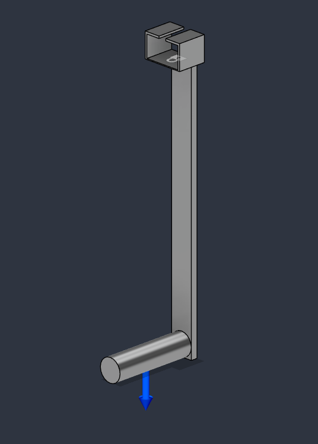
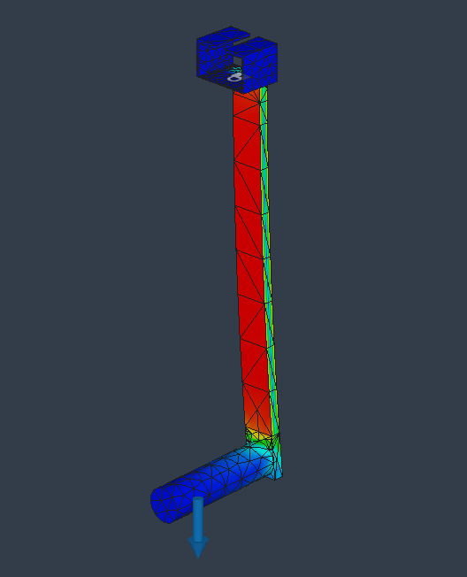

### Revision #1
####Changes
After the initial run I noticed the safety factor was much too low. In order to increase the safety factor I increased the cross sectional area of the longest feature in the design.
#### 1st run
Stress: 117.04 MPa, location: fiber of longest feature facing the circular feature
Displacement: 10.46mm, location: end of circular feature
Mass: 72.902 ounce mass
Safety Factor: 3.153 lowest
number of elements: 1545
#### 2nd run
Stress: 102.886 MPa, location: fiber of longest feature facing the circular feature
Displacement: 10.443mm, location: end of circular feature
Mass: 72.902 ounce mass
Safety Factor: 3.587 lowest
 of elements: 2205
#### 3rd run
Stress: 98.597 MPa, location: fiber of longest feature facing the circular feature
Displacement: 10.445mm, location: end of circular feature
Mass: 72.902 ounce mass
Safety Factor: 3.743 lowest
 of elements: 2085

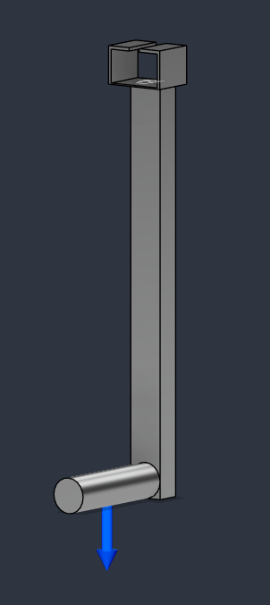
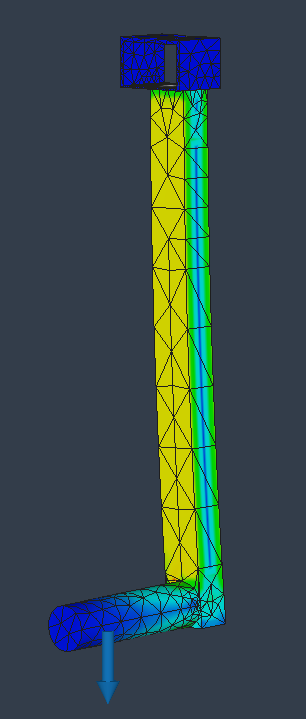

### Revision #2
#### Changes
Added a triangular brace to reduce deflection and made cuts to reduce weight in areas that aren’t bearing much load. 
#### 1st run
Stress: 160.84 MPa, location: fiber of longest feature facing the circular feature
Displacement: 4.825mm, location: end of circular feature
Mass: 65.373 ounce mass
Safety Factor: 2.294 lowest
number of elements: 4518
#### 2nd run
Stress: 160.589 MPa, location: fiber of longest feature facing the circular feature
Displacement: 4.832mm, location: end of circular feature
Mass: 65.373 ounce mass
Safety Factor: 2.298 lowest
number of elements: 8355
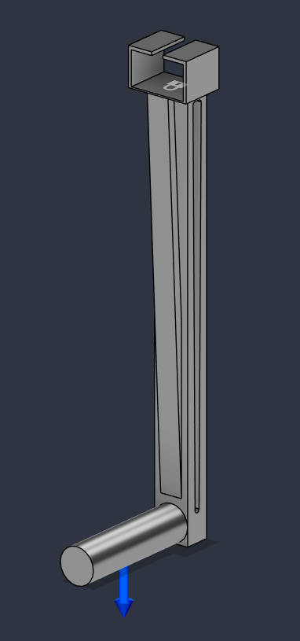
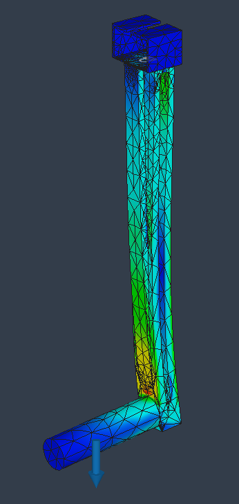
### Revision #3
#### Changes
Removed material from low stress areas in the upper portion of the part
#### 1st run
Stress: 167.815 MPa, location: fiber of longest feature facing the circular feature
Displacement: 4.829mm, location: end of circular feature
Mass: 64.847 ounce mass
Safety Factor: 2.199 lowest
Number of elements: 5339
#### 2nd run
Stress: 164.628 MPa, location: fiber of longest feature facing the circular feature
Displacement: 4.829mm, location: end of circular feature
Mass: 64.847 ounce mass
Safety Factor: 2.241 lowest
Number of elements: 6278
#### 3rd run
Stress: 46.598 MPa, location: at the point load underneath the smallest hole
Displacement: 0.02mm, location: at the point load underneath the smallest hole
Mass: 3.653 ounce mass
Safety Factor: 7.919 lowest
Number of  elements: 1344

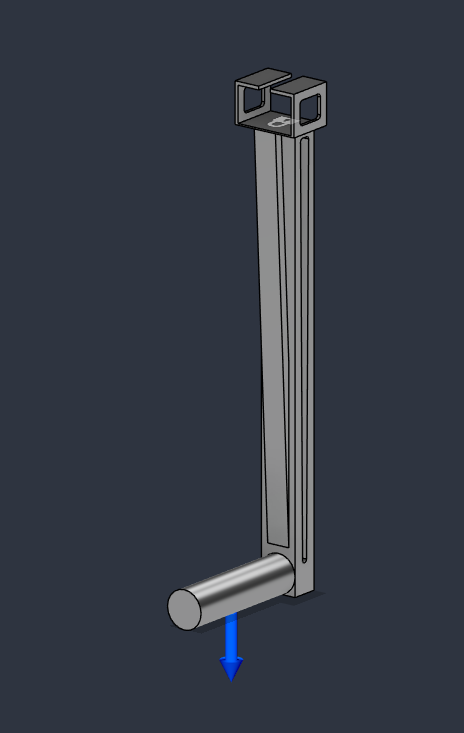
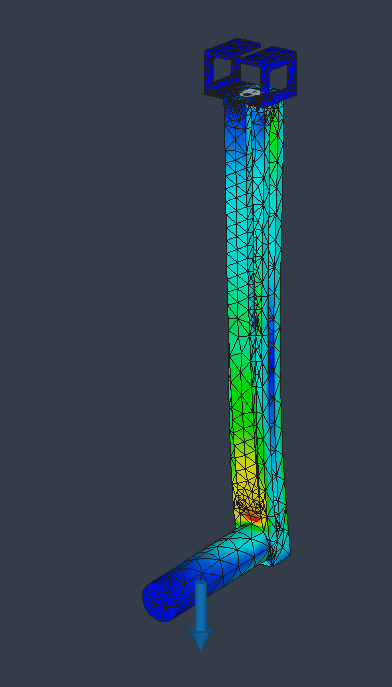

## Link
[CadFile](
### Original Design
Material: 6061 T6 Cold Formed Aluminum
#### 1st Run
Stress: 39.635 MPa, location: at the point load underneath the smallest hole
Displacement: 0.019mm, location: at the point load underneath the smallest hole
Mass: 3.653 ounce mass
Safety Factor: 9.31 lowest
Number of elements: 204
#### 2nd Run
Stress: 44.279 MPa, location: at the point load underneath the smallest hole
Displacement: 0.02mm, location: at the point load underneath the smallest hole
Mass: 3.653 ounce mass
Safety Factor: 8.33 lowest
Number of elements: 378
#### 3rd Run
Stress: 46.598 MPa, location: at the point load underneath the smallest hole
Displacement: 0.02mm, location: at the point load underneath the smallest hole
Mass: 3.653 ounce mass
Safety Factor: 7.919 lowest
Number of  elements: 1344
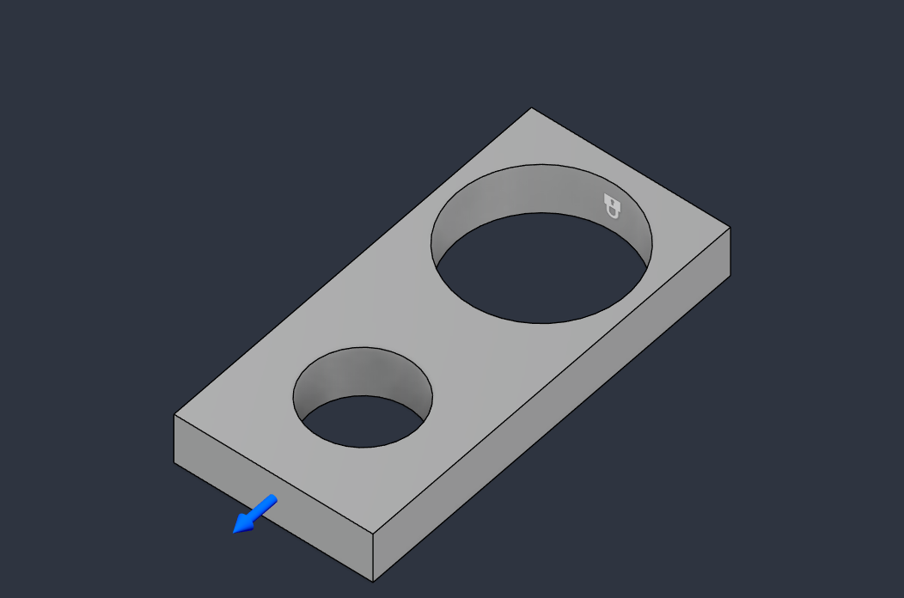
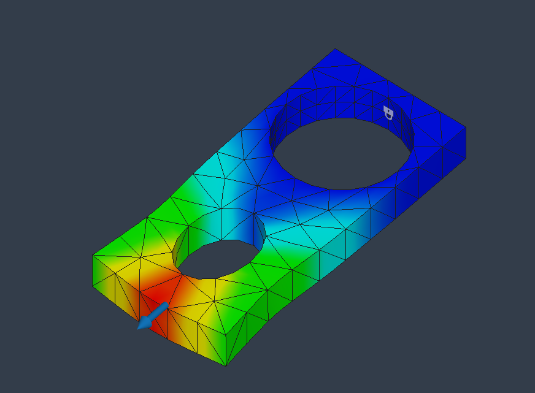
### Revision #1
#### Changes
Removed material in low stress regions
#### 1st run
Stress: 52.136 MPa, location: at the point load underneath the smallest hole
Displacement: 0.031mm, location: at the point load underneath the smallest hole
Mass: 3.235 ounce mass
Safety Factor: 7.071 lowest
Number of  elements: 423
#### 2nd run
Stress: 60.488 MPa, location: at the point load underneath the smallest hole
Displacement: 0.032mm, location: at the point load underneath the smallest hole
Mass: 3.235 ounce mass
Safety Factor: 6.10 lowest
Number of  elements: 534
#### 3rd run
Stress: 59.511 MPa, location: at the point load underneath the smallest hole
Displacement: 0.032mm, location: at the point load underneath the smallest hole
Mass: 3.235 ounce mass
Safety Factor: 6.20 lowest
Number of  elements: 1200
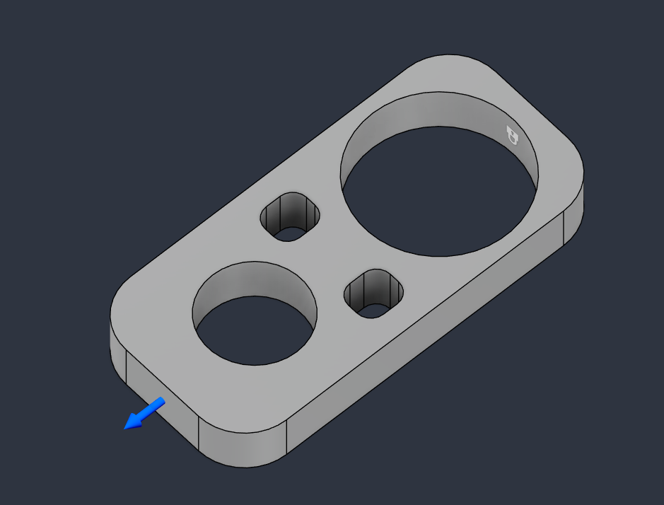
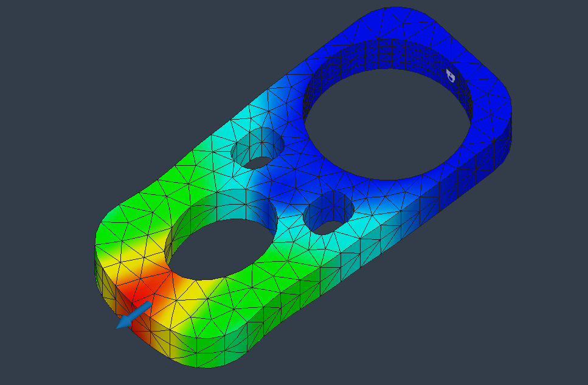
### Revision #2
#### Changes
Removed material in low stress regions
#### 1st Run
Stress: 68.054 MPa, location: at the point load underneath the smallest hole
Displacement: 0.033mm, location: at the point load underneath the smallest hole
Mass: 3.021 ounce mass
Safety Factor: 5.422 lowest
Number of  elements: 276
#### 2nd Run
Stress: 59.893 MPa, location: at the point load underneath the smallest hole
Displacement: 0.033mm, location: at the point load underneath the smallest hole
Mass: 3.021 ounce mass
Safety Factor: 6.161 lowest
Number of  elements: 324
#### 3rd Run
Stress: 69.515 MPa, location: at the point load underneath the smallest hole
Displacement: 0.033mm, location: at the point load underneath the smallest hole
Mass: 3.021 ounce mass
Safety Factor: 5.308 lowest
Number of  elements: 936
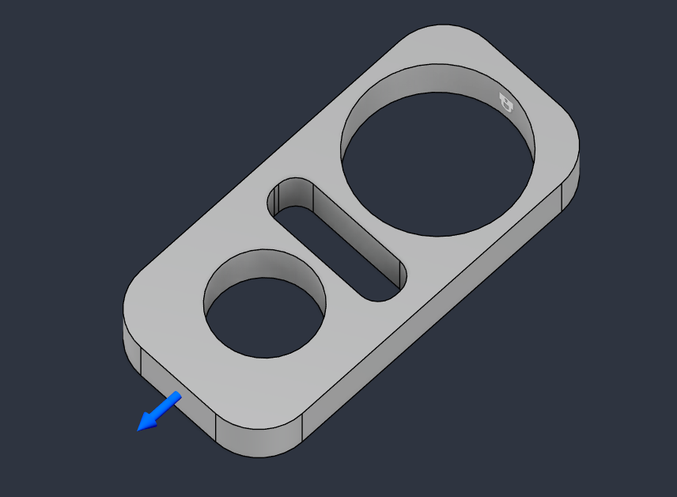
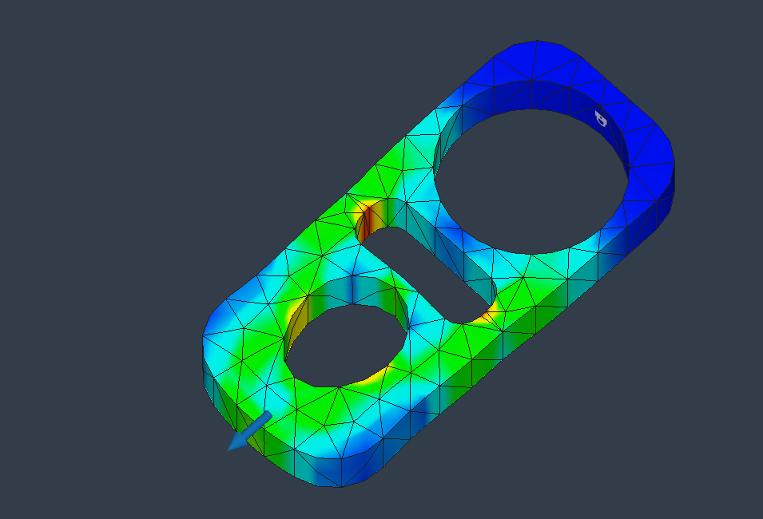
### Revision #3
#### Changes
Removed material in low stress regions
#### 1st Run
Stress: 52.257 MPa, location: at the point load underneath the smallest hole
Displacement: 0.036mm, location: at the point load underneath the smallest hole
Mass: 2.899 ounce mass
Safety Factor: 7.061 lowest
Number of  elements: 468
#### 2nd Run
Stress: 52.861 MPa, location: at the point load underneath the smallest hole
Displacement: 0.037mm, location: at the point load underneath the smallest hole
Mass: 2.899 ounce mass
Safety Factor: 6.981 lowest
Number of  elements: 1392
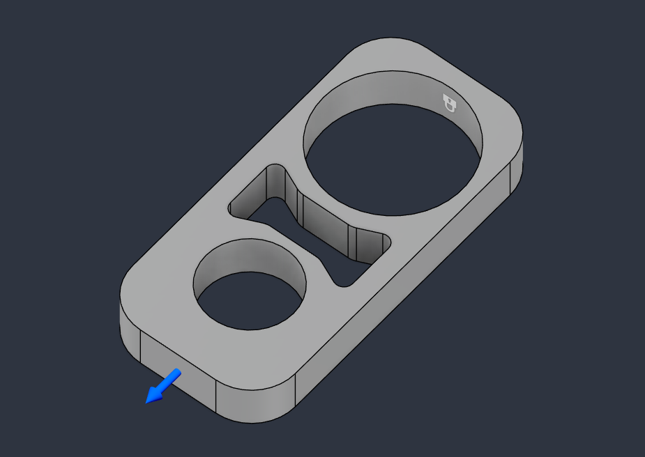
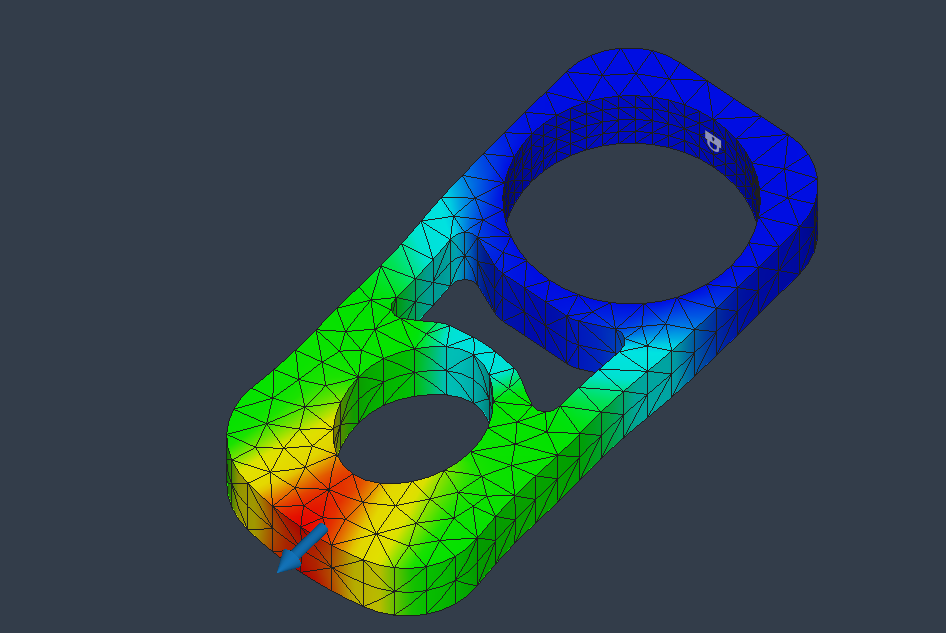
## Communicate
After completing this assignment I have gained valuable experience as this was my first time using FEA. I enjoyed getting to see the visualization of stresses inside of the part and optimizing it for its intended purpose. One of the main things I learned is that in Fusion360 its best to keep the mesh moderately fine but then use the adaptive mesh refinement tool to automatically decrease the mesh size near areas with large changes in stress.
