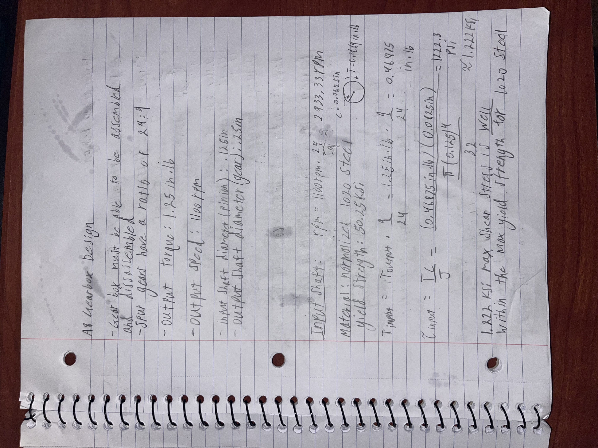
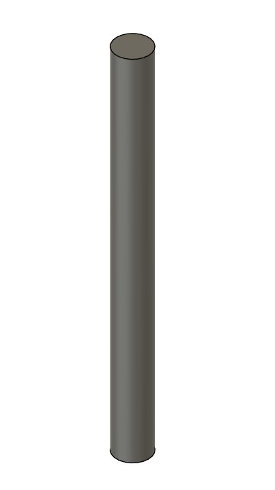
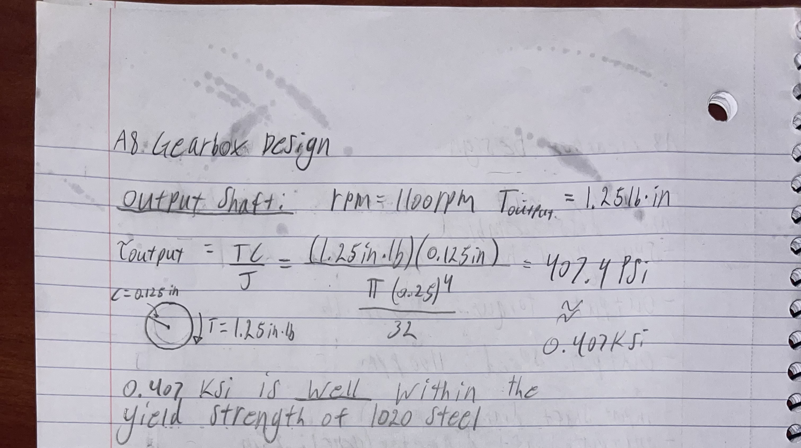

# A8 – Gears

## Objective
The Main objective of this assignment was to create a simple gearbox using a pinion and gear designated from Mcmaster Carr. We were to do this using predetermined shaft sizes, predetermined output torque, and predetermined output RPM. Using those given values we would choose an appropriate journal bearing from Mcmaster Carr to hold the shafts of the gears.

## Analyze
My process for this assignment was to solve for the shear stress in the shafts to make sure they wouldn't fail. After that I went onto doing the calculations for the loads that the bearings would experience then choosing a material from the table in the slides given. After choosing my material I did calulcations for the wall thickness needed in that specified material to support the pressures from the shafts. Once I had done all of these things I could choose a journal bearing in Mcmaster Carr that satisfies all the of criteria.

## Decide
### Input Shaft
#### Calculations

#### Cad

### Output Shaft Calculations

## Communicate

