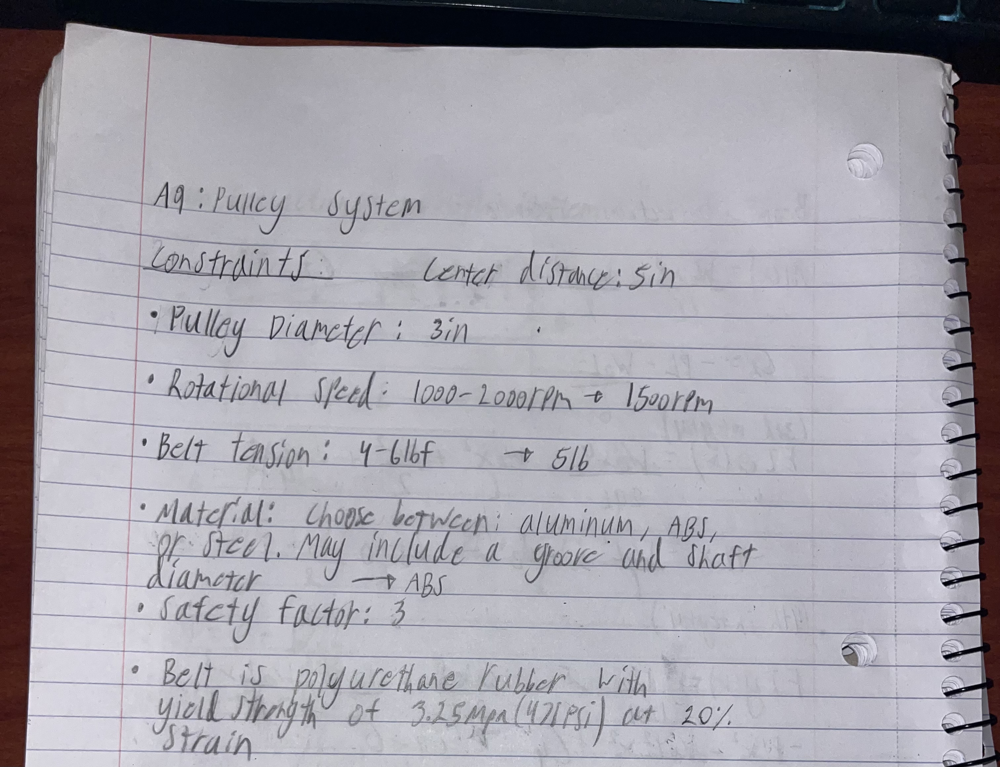
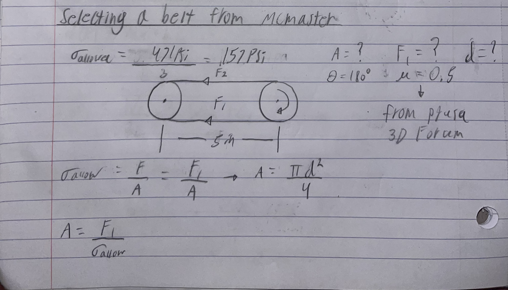
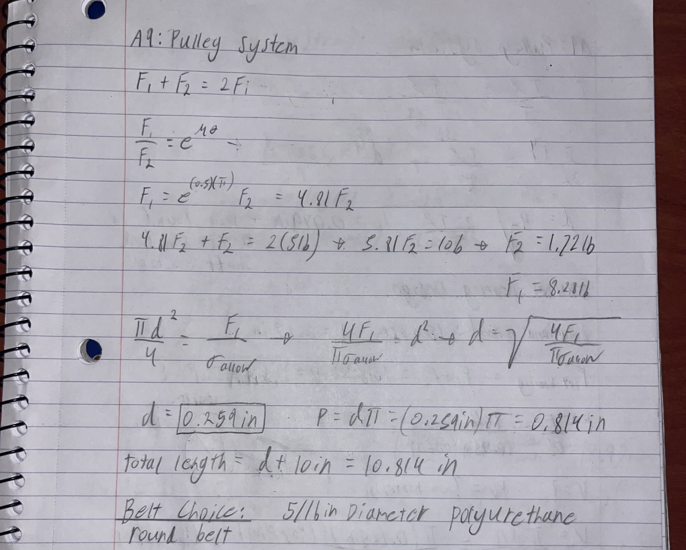
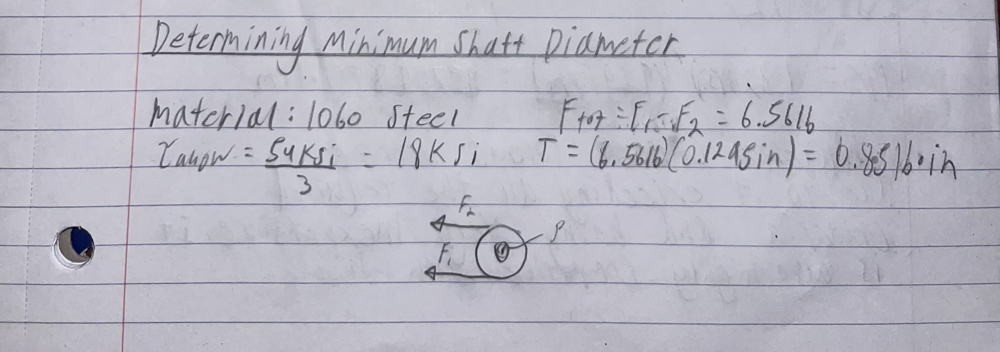
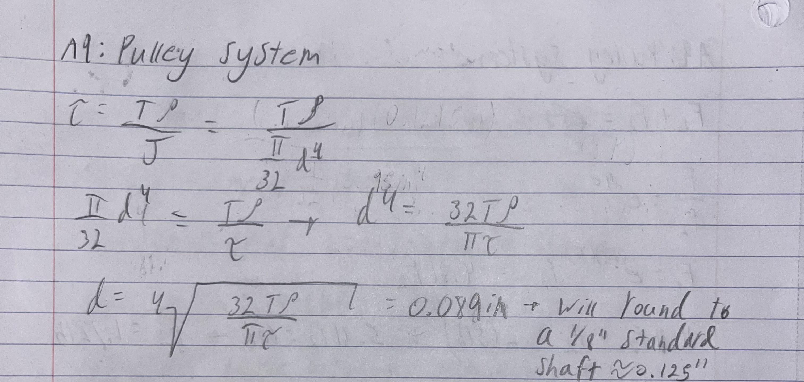
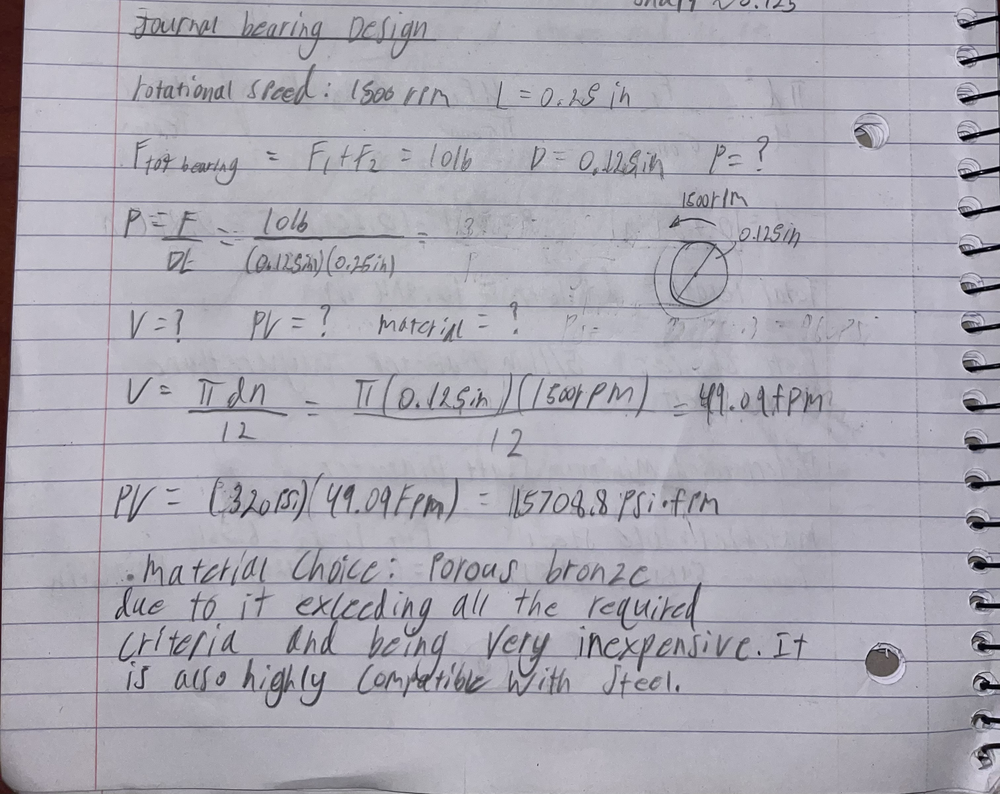

# A9 – Pulleys

## Objective
The Main objective of this assignment was to create a simple pulley system that would have two pulleys with a belt tension of 5lb.

## Analyze
In this assignment my process was to first calculate the belt diameter needed to handle the forces of the pulleys rotating. After choosing the correct belt diameter I would do the calculations to find the minimum diameter for the shaft's that would hold these pulleys. Then I would use my calculations to determine the ideal material for journal bearings that would hold the shafts. Finally I would design a frame to hold this pulley system. 

## Decide
### Constraints 
The constraints that I got to choose for the pulley system

### Calculations for Belt Diameter

For round polyurethane belts on McMaster the 5/16in was the closest next size up which is why I selected that belt.
### Calculations for Shaft Diameter

rounded up the shaft size to 1/8in since that is a more standard size that can be bought readily.
### Journal Bearing Calculations

## Communicate

