## Objective

We continued the design of the benchtop tensile tester from A10. We selected motors for the two leadscrews, designed their mounts and shaft connections, and laid out the frame connections and lower bearing supports. The frame revision makes room for the drive hardware while keeping the leadscrews 6 in apart.

<a href="images/assembly.jpg">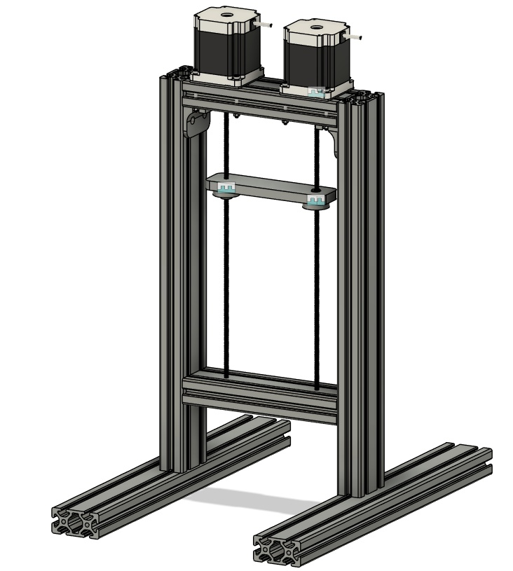</a> <b>Figure 1.</b> Isometric CAD view of the assembled tensile tester.

## Requirements and design inputs

| Input | Value |
|---|---|
| Maximum specimen load | 2,000 N |
| Nominal load per screw | 1,000 N, with centered loading and equal sharing |
| Crosshead speed | 1–50 mm/min |
| Required safety factor | 4 |
| A10 leadscrew | Single-start 1/4″–16 Acme, 18 in long |
| Screw lead | 1.5875 mm/rev |
| Screw-center spacing | 6 in (152.4 mm) |
| Top frame | 12 in (304.8 mm) long, heavy 40 Series, 80 × 40 mm extrusion |

## Motor selection — Patrick Klauser

We chose two MOONS’ 34HC1308 stepper motors. Our notes use 3.82 N·m at about 30 rpm for motor selection and record a curve reading of about 4.16 N·m at 50 rpm. The motor datasheet lists 5.4 N·m of holding torque.

<a href="images/motor-curve.jpg">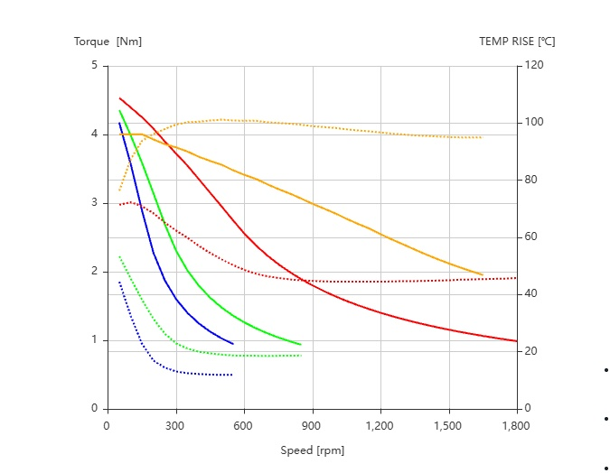</a> <b>Figure 2.</b> Motor curve included in the team report.

## Motor mount — Patrick Klauser

We chose 0.125-in 1018 cold-rolled steel for the motor mount. Switching to an 80 × 40 mm extrusion made room beneath the four motor mounting holes.

<table><tr><td align="center" valign="top" width="50%"><a href="images/mount-plate.jpg">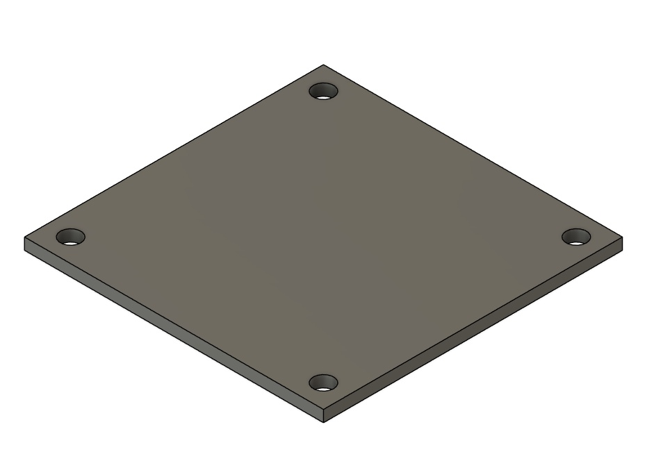</a> <b>Figure 3.</b> Motor mount plate.</td><td align="center" valign="top" width="50%"><a href="images/mount-installed.jpg">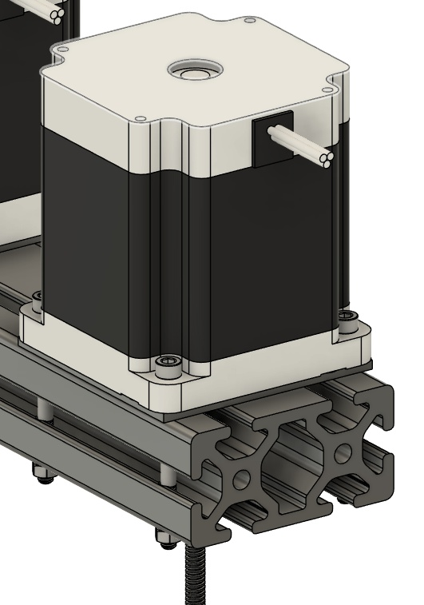</a> <b>Figure 4.</b> Motor and mount on the wider extrusion.</td></tr></table>

<a href="images/mount-handwork.jpg">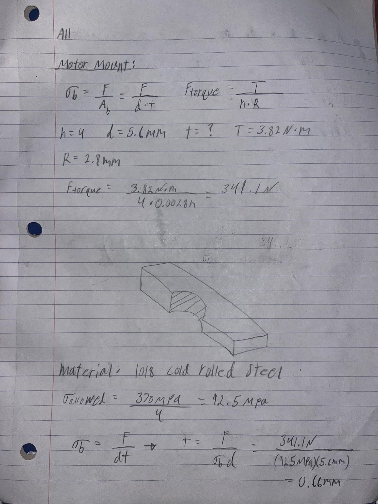</a> <b>Figure 5.</b> Our original motor mount calculation.

## Coupler selection — Patrick Klauser

We chose a flexible clamping coupler to grip the shafts and accommodate small alignment differences. The coupler opening helped drive the change to a wider extrusion.

<table><tr><td align="center" valign="top" width="50%"><a href="images/coupler.jpg">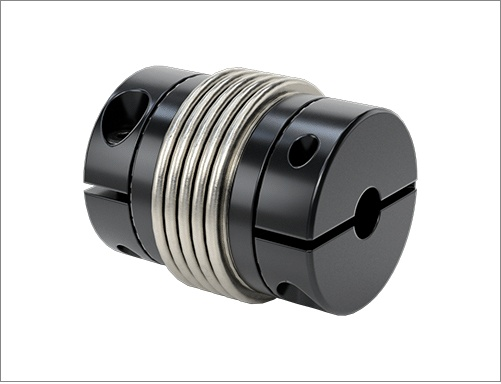</a> <b>Figure 6.</b> Flexible clamping coupler.</td><td align="center" valign="top" width="50%"><a href="images/coupler-handwork.jpg">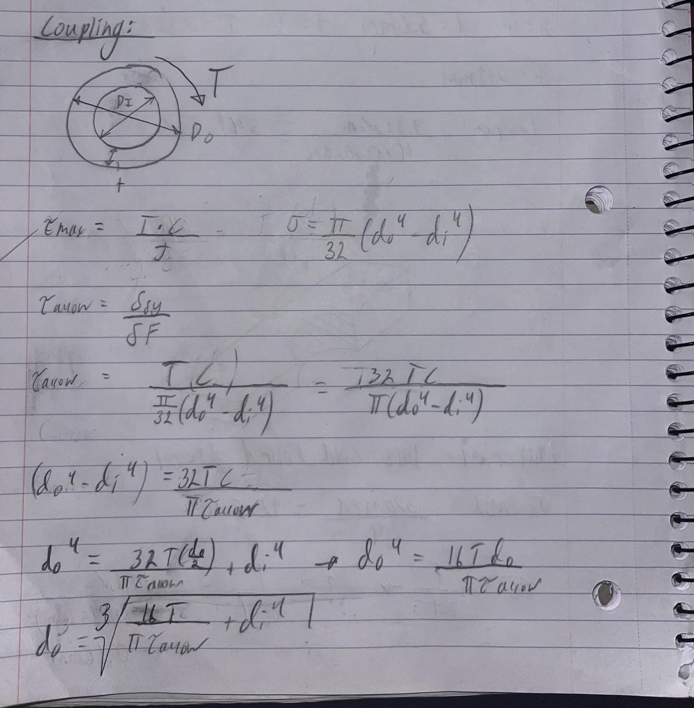</a> <b>Figure 7.</b> Our original torsion sketch and equations.</td></tr></table>

<a href="images/coupler-numbers.jpg">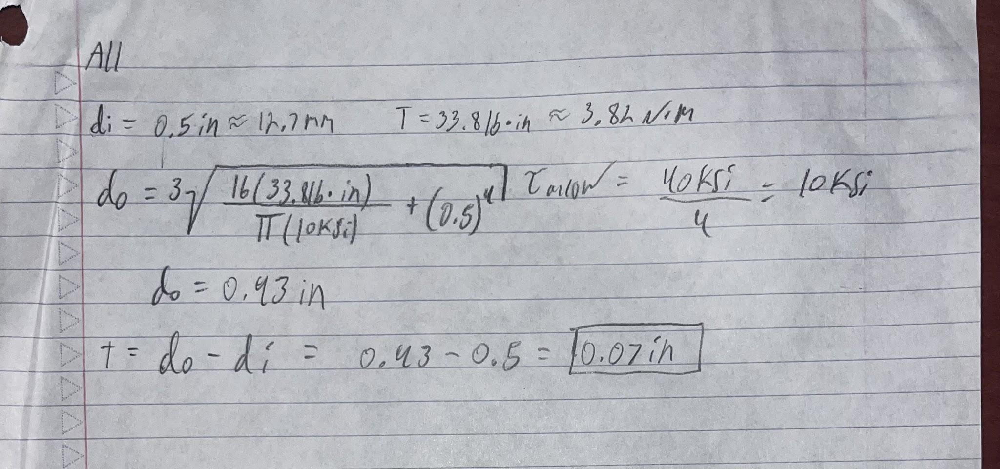</a> <b>Figure 8.</b> Our original coupler calculation.

## Frame and motor twist — Rick Bhattacharya

Our hand calculation uses the two motors’ holding torques to find the sideways forces at the ends of the frame. The sketch below shows the calculation for the trial bracket.

<a href="images/frame-handwork.jpg">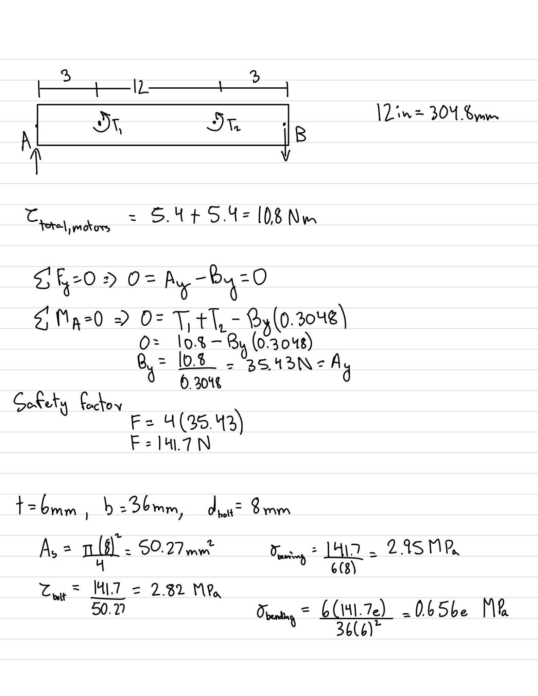</a> <b>Figure 9.</b> Our original frame sketch and bracket calculations.

<a href="images/frame-bracket.jpg">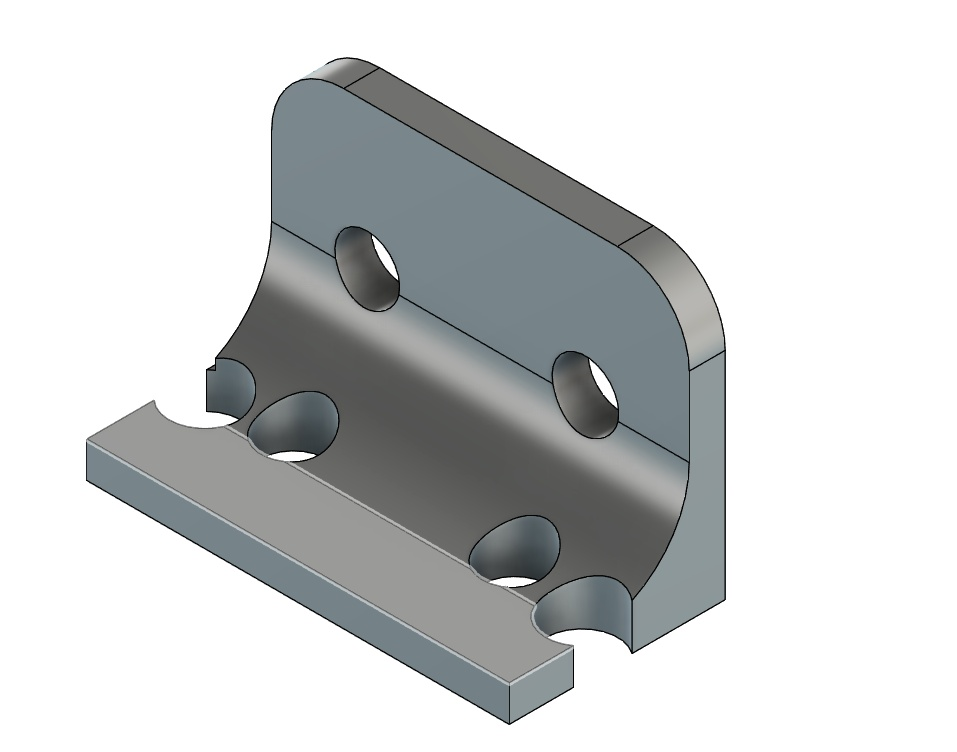</a> <b>Figure 10.</b> CAD view of the modeled connector.

## Top frame FEA — Rick Bhattacharya

The study represents the top beam restrained at the ends and loaded at the screw locations. The intended case combines two 1,000 N axial forces and two motor reaction moments.

| Baseline result | Value |
|---|---:|
| Maximum von Mises stress shown on plot | 20.536 MPa |
| Maximum displacement magnitude shown on plot | 0.012 mm |
| Safety factor recorded in the notes | About 13; exact value not visible on the plot |

<a href="images/fea-setup.jpg">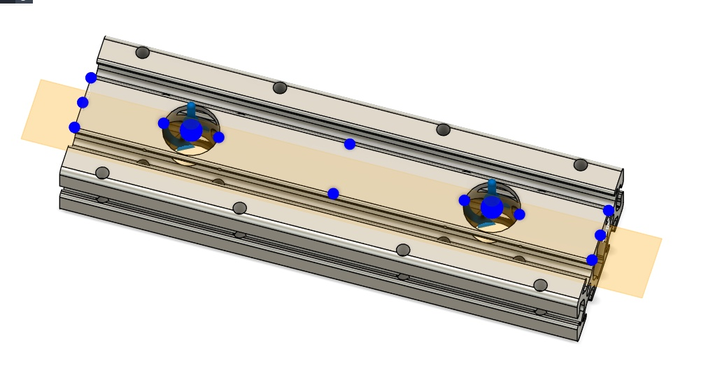</a> <b>Figure 11.</b> Top extrusion and the screw and bracket interface locations used in the study.

<table><tr><td align="center" valign="top" width="50%"><a href="images/fea-stress.jpg">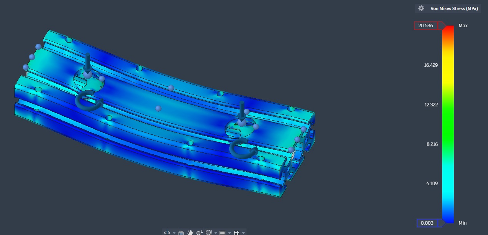</a> <b>Figure 12.</b> Baseline von Mises stress contour.</td><td align="center" valign="top" width="50%"><a href="images/fea-displacement.jpg">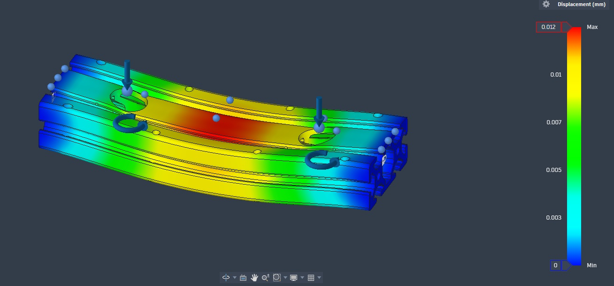</a> <b>Figure 13.</b> Baseline displacement magnitude.</td></tr></table>

<table><tr><td align="center" valign="top" width="50%"><a href="images/fea-safety.jpg">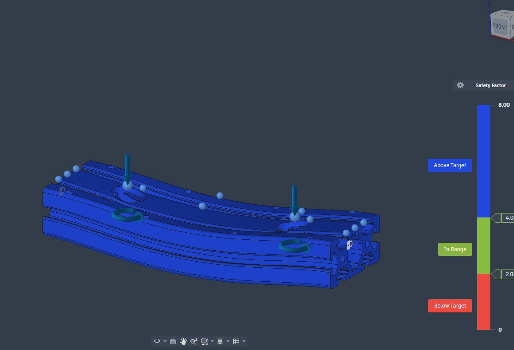</a> <b>Figure 14.</b> Safety-factor contour and target band.</td><td align="center" valign="top" width="50%"><a href="images/fea-proposed.jpg">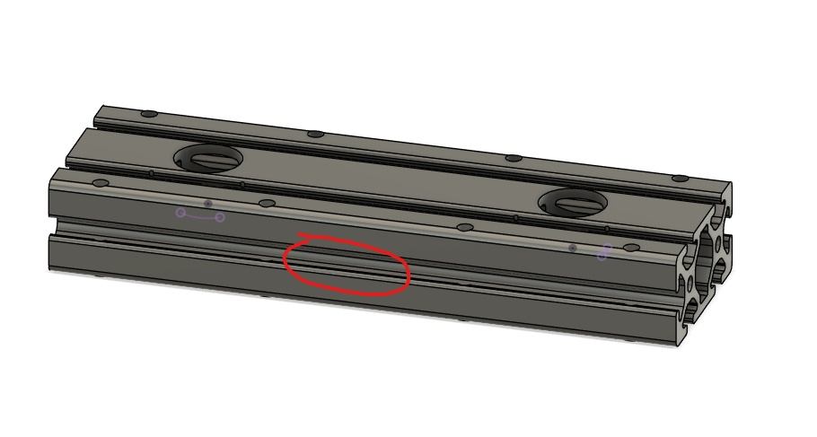</a> <b>Figure 15.</b> Proposed hole in a lightly stressed region near midspan.</td></tr></table>

The displacement magnitude is highest near midspan. A hole in the region marked in red was proposed for weight reduction. The grip-line vertical displacement, exact peak-stress location, mesh convergence and revised simulation results were not recorded in the available study.

## Vertical frame FEA — Rick Bhattacharya

No separate upright simulation results were recorded in the team report.

## Floating bearing mount — Antonio Chiocca

The lower mount supports the screw radially while it rotates and provides the floating support. Four fasteners attach the 1.50 × 1.50 in housing to the lower frame. The housing has raised bolt seats and rounded corners.

| Feature | Drawing dimension |
|---|---|
| Housing height | 0.3125 in |
| Housing fastener holes | Four Ø0.1969 in, with +0.0002 in shown |
| Inner bearing | Ø0.250 in bore with +0.0006 in shown, Ø0.400 in OD, 0.375 in long |
| Outer bearing | Ø0.400 in ID, Ø0.600 in OD, 0.275 in long |

Our design calls for an RC3 fit at the leadscrew opening. The drawings below show the dimensions our team recorded.

<a href="images/bearing-mount.jpg">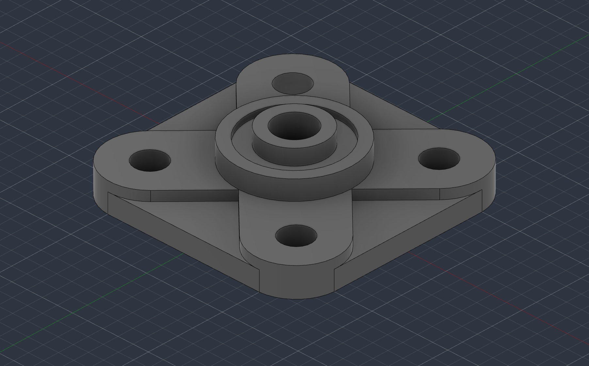</a> <b>Figure 16.</b> CAD view of the lower housing, bearing stack and four mounting locations.

## Drawing package — Antonio Chiocca

### Frame connector and motor bracket drawings

The frame connector sheet records the two mounting faces, the 0.25 in leg thickness and the Ø0.45 and Ø0.50 in openings. The motor bracket sheet locates the four Ø0.22 in holes on a 3.24 in square plate. 

<a href="files/frame-connector.pdf">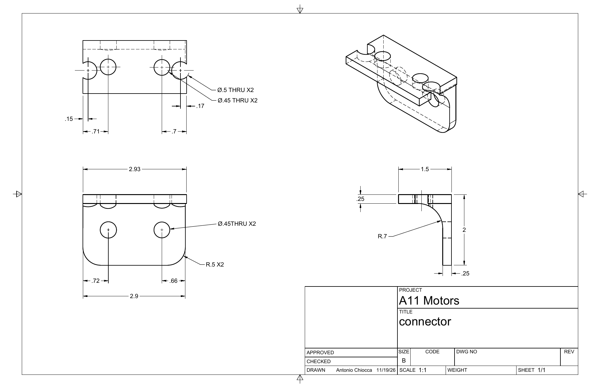</a> <b>Frame connector · PDF</b> (click for the original PDF)

<a href="files/motor-bracket.pdf">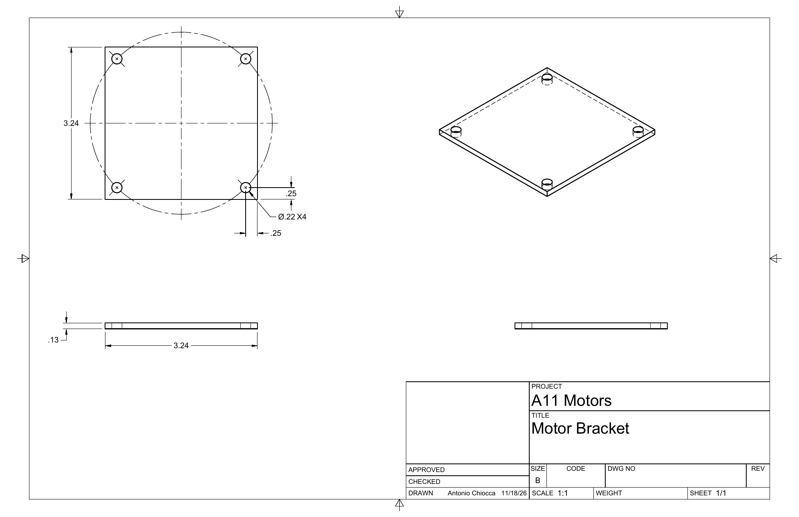</a> <b>Motor bracket · PDF</b> (click for the original PDF)

### Floating bearing drawings

The three bearing sheets show the housing, inner bearing and outer bearing separately. They document the mating diameters, component heights and the four fastener locations, so the bearing stack can be checked part by part.

<a href="files/bearing-housing.pdf">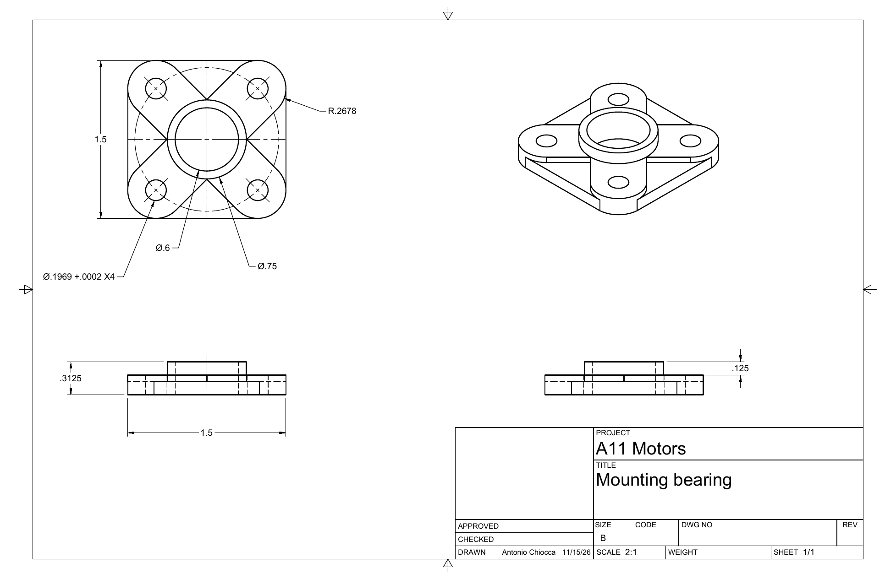</a> <b>Floating bearing housing · PDF</b> (click for the original PDF)

<a href="files/inner-bearing.pdf">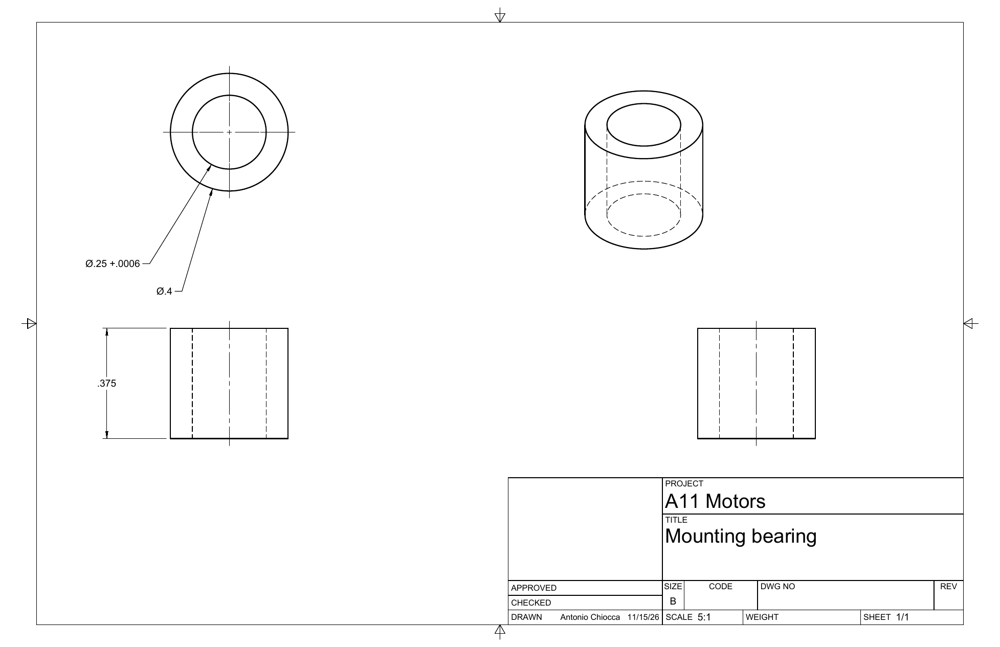</a> <b>Inner bearing · PDF</b> (click for the original PDF)

<a href="files/outer-bearing.pdf">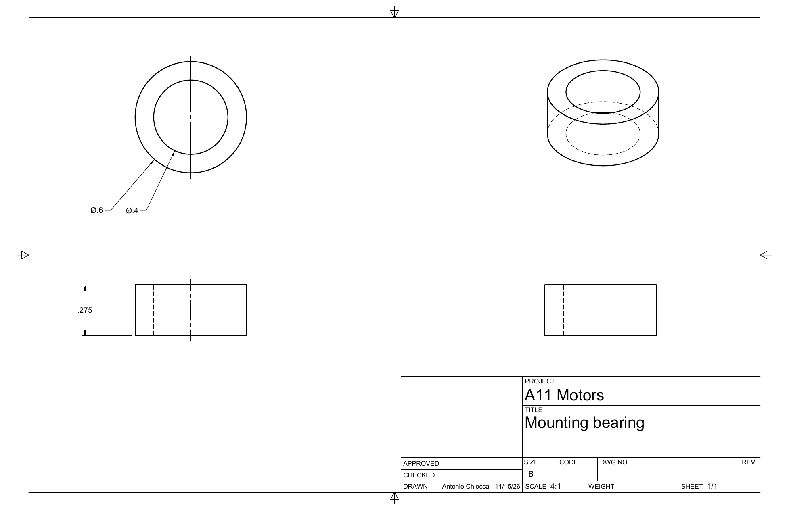</a> <b>Outer bearing · PDF</b> (click for the original PDF)

### Crosshead drawing

<a href="files/crosshead.pdf">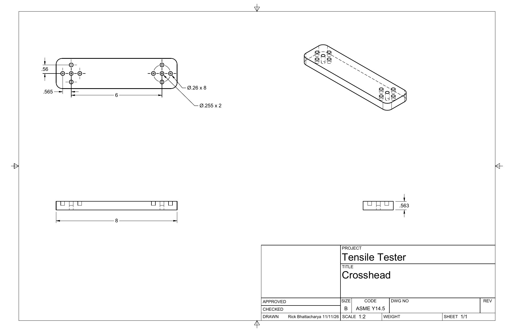</a> <b>Crosshead · PDF</b> (click for the original PDF)

The isometric assembly view is shown with the objective. The Fusion archive includes the referenced components.

## Bill of materials and labor — Antonio Chiocca

| A11 purchase | Quantity | Extended cost |
|---|---:|---:|
| MOONS’ 34HC1308 motors | 2 | $340.00 |
| McMaster 6446K566 flexible couplers | 2 | $303.42 |
| M5 bolts | 8 | $5.88 |

 <b>A11 bill of materials · PDF</b> (click for the original PDF)

| Team member | Recorded hours |
|---|---:|
| Rick Bhattacharya | 4 |
| Antonio Chiocca | 3 |
| Patrick Klauser | 5 |

The assignment uses a labor rate of $35 per hour. The source [A10 BOM](files/a10-bom.pdf) and A11 BOM list the part costs.

## Lessons learned

- **Check torque at the working speed.** The 5.4 N·m holding rating applies to a stationary shaft. We used the torque curve to compare the motor with the speed and torque in our notes.
- **Lay out the drive as an assembly.** The first extrusion left too little room around the coupler and no material beneath the motor bolt pattern. Placing both components and their fasteners in the same layout earlier would have caught the interference before the frame changed.
- **Use the real moment arm.** The mounting worksheet used the hole radius to turn torque into bolt force. The drawing gave us the actual distance from the shaft axis to the bolt center. The same principle applies to the frame calculation, where the distance between supports sets the reaction force.
- **Dimension the bearing and mounting interfaces separately.** The shaft needs a running fit, the lower bearing needs room to float, and the bolts need assembly clearance. Each callout has a different job and needs its own check.
- **Compare FEA changes against a baseline.** The first contour helped us find a possible location for a weight reduction hole. Repeating the study with the same loads and comparable mesh settings would show whether the hole changes grip-line stiffness or moves the peak stress.

## CAD files and supporting documents

- [Fusion tensile tester assembly](files/tensile-tester.f3z)
- [A11 team submission PDF](files/A11-team-report.pdf)
- [Original design notes and calculations](files/a11-working-report.pdf)
- [A11 bill of materials](files/a11-bom.pdf) and [A10 bill of materials](files/a10-bom.pdf)

## References

- [MOONS’ 34HC1308 product specifications, drawings and torque curves](https://www.moonsindustries.com/p/nema-34-smooth-hybrid-stepper-motors/34hc1308-000004611110015035)
- [80/20 40 Series trial corner bracket and hardware](https://8020.net/40-4302.html)
- [McMaster flexible coupler](https://www.mcmaster.com/6446K566/)
